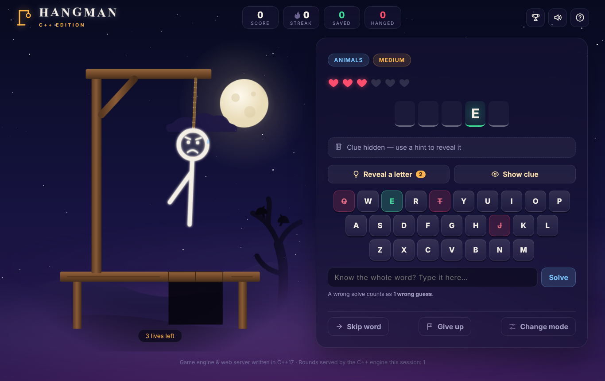
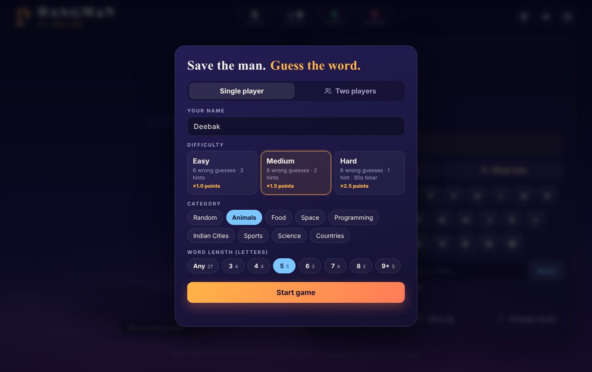
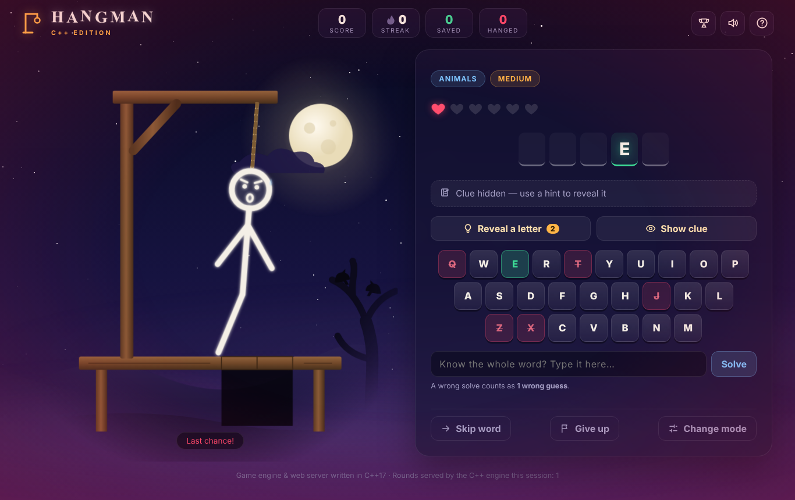
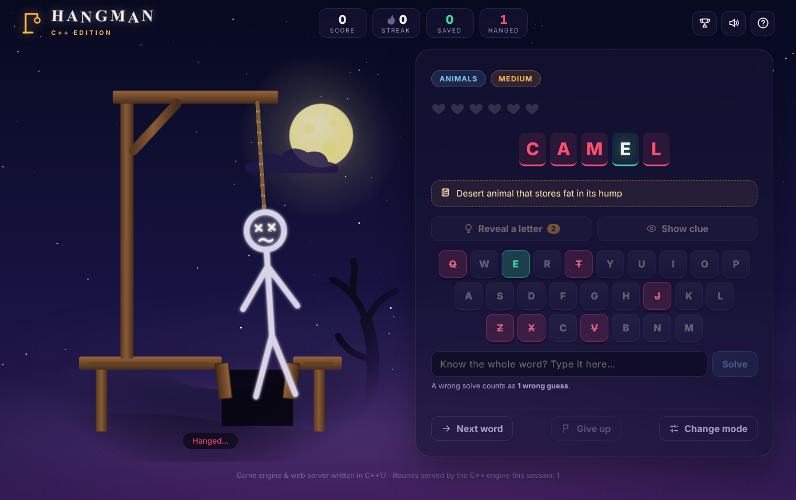
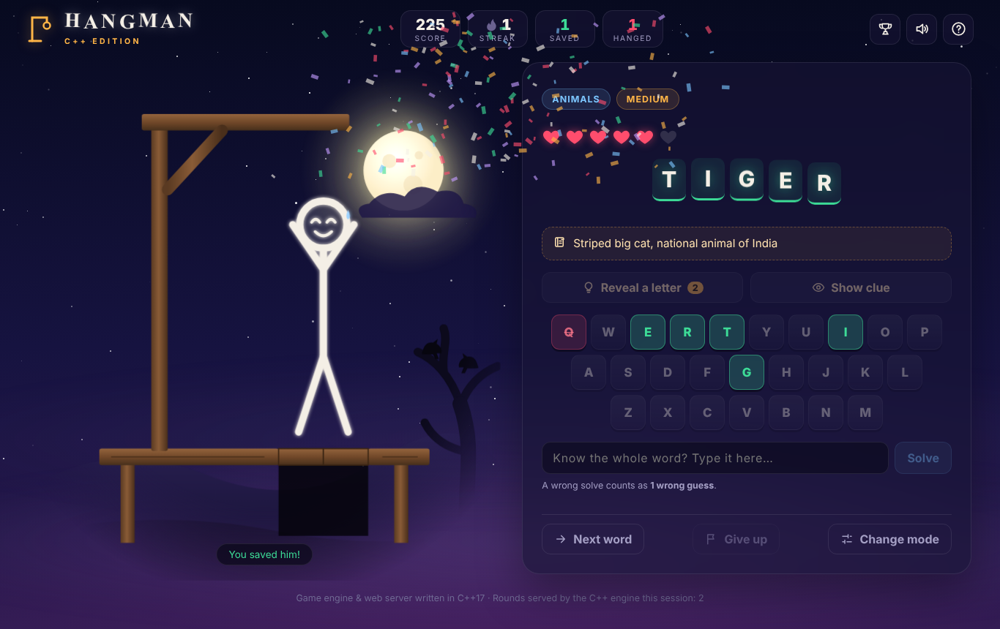
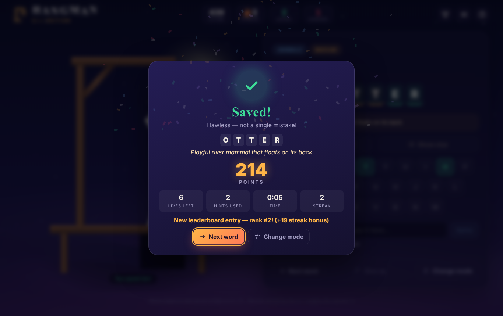
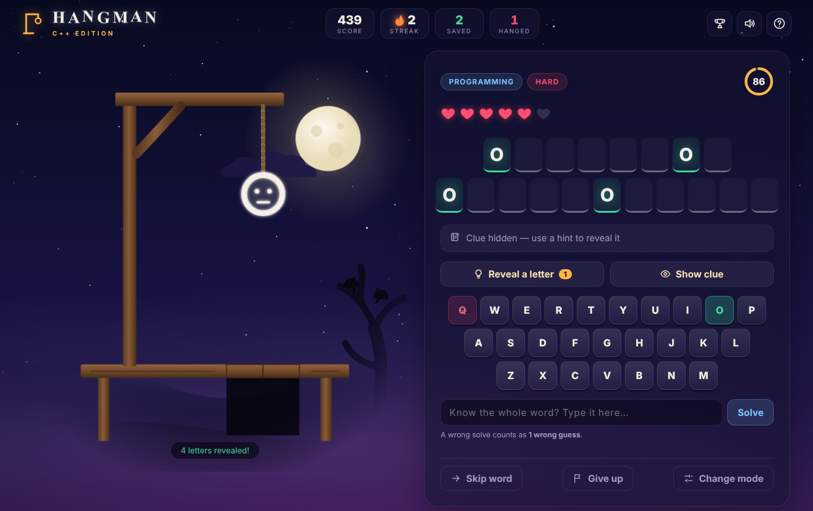
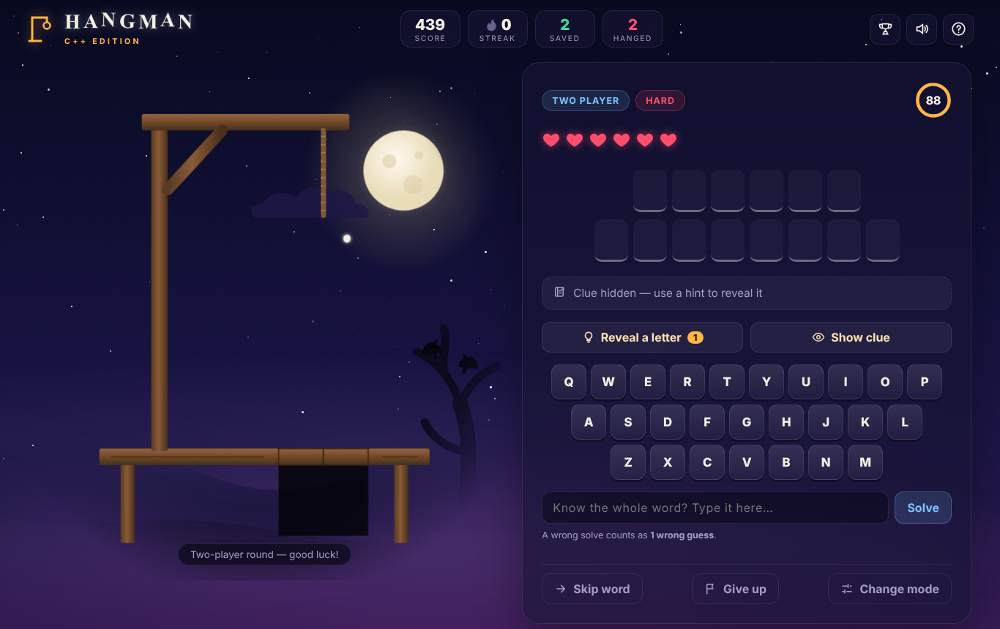

# Hangman — C++ Edition

**DSA0106 – Object Oriented Programming with C++ · Capstone Project**

A complete Hangman game whose entire game engine is written in **C++17**. It has two front ends: an animated browser interface, served by an HTTP server written from scratch in C++, and a classic terminal version with ASCII art. No external libraries are used, only the C++ standard library and the operating system's sockets.



---

## Quick start (Windows)

1. Unzip the project.
2. Double-click **`run.bat`** (or `hangman.exe`).
3. Your browser opens at `http://localhost:8080` and the game starts.
   Keep the black console window open while you play; closing it stops the game.

Prefer the terminal? Double-click **`play_console.bat`**.

`hangman.exe` is already compiled, so you do not need a compiler to play.

### Building from source

| Platform | Command |
|---|---|
| Windows (MinGW-w64 g++) | `build.bat` |
| Windows (manual) | `g++ -std=c++17 -O2 -Iinclude src\*.cpp -o hangman.exe -lws2_32` |
| Linux / macOS | `make` then `./hangman` |
| Run the tests | `run_tests.bat` or `make test` |

Command-line options: `--console` (terminal mode), `--port N` (default 8080; the next free port is used if busy), `--no-browser`.

---

## Features

**Gameplay**
- 183 words in 8 categories (Animals, Food, Space, Programming, Indian Cities, Sports, Science, Countries), each with a clue
- 3 difficulty levels:
- **Choose the word length** before starting: Any, 3, 4, 5, 6, 7, 8 or 9+ letters. The start screen shows how many words each length has in the chosen category, and the C++ engine picks a word of exactly that length
- **6 wrong guesses** on every level: each wrong guess draws one more part of the hangman (head, body, left arm, right arm, left leg, right leg), and the sixth one hangs him
- 3 difficulty levels:
  | Level | Wrong guesses | Hints | Word length for "Any" | Timer | Points |
  |---|---|---|---|---|---|
  | Easy | 6 | 3 | 3–7 | – | ×1.0 (clue shown) |
  | Medium | 6 | 2 | 5–10 | – | ×1.5 |
  | Hard | 6 | 1 | 8+ | 90 s | ×2.5 |
- Guess letters with the on-screen keyboard or your physical keyboard
- **Solve** the whole word at once (a wrong solve counts as one wrong guess)
- **Hints**: reveal a random letter or show the clue
- **Two-player mode**: Player 1 types a secret word and optional clue, and Player 2 guesses it
- Multi-word phrases (e.g. *SNOW LEOPARD*, *VIRTUAL FUNCTION*)
- Scoring with a streak bonus, plus session stats (score, streak, saved, hanged)
- **Persistent Top-10 leaderboard** saved to `data/scores.txt`
- Words never repeat within the last 15 rounds

**Front end and animations**
- Night-sky scene with a glowing moon, twinkling stars, drifting fog and a dead tree with crows
- The gallows builds itself plank by plank, and each wrong guess draws the next body part in chalk
- The man's **face reacts**: smiling, then nervous, worried and frowning, then sweating and terrified on the last life
- Each wrong guess makes the screen shake, flashes a red vignette and breaks a heart; the noose sways more and more
- At 2 lives left, lightning and thunder hit and the hearts pulse
- **Losing**: the trapdoor opens, the man drops and swings, his eyes become X's, the moon turns red and the crows fly away
- **Winning**: the noose lifts away, the man jumps with his arms up and confetti bursts
- Letter tiles flip with sparkles, keys turn green or red, and points count up on the result card
- Synthesised sound effects (Web Audio, no audio files), with a mute button
- Responsive layout for laptop, tablet and phone; respects *reduced motion* settings

---

## How it works

```
 Browser (web/index.html, style.css, app.js)
     │  fetch("/api/guess?letter=E")        ← only sends actions, has no game rules
     ▼
 HttpServer  (raw sockets: Winsock on Windows, BSD sockets on Linux/macOS)
     ▼
 WebApp      (routes requests, builds JSON replies, records results)
     ▼
 Game  ──uses──▶ Difficulty (Easy / Medium / Hard)       Player (stats, streak)
   ▲                                                      Scoreboard (data/scores.txt)
   └── WordBank (data/words.txt)
```

The JavaScript only draws what the C++ engine reports. The engine decides whether a guess is right, how many lives remain, whether the timer expired, the score and the leaderboard rank. The terminal version (`ConsoleGame`) reuses exactly the same `Game`, `WordBank`, `Player` and `Scoreboard` classes.

### Project structure

```
Hangman-CPP/
├── hangman.exe            ready-to-run Windows build
├── run.bat / play_console.bat / build.bat / run_tests.bat
├── Makefile               Linux / macOS build
├── include/               class declarations (.h)
│   ├── Game.h  Difficulty.h  WordBank.h  Player.h  Scoreboard.h
│   ├── GameExceptions.h  Json.h  HttpServer.h  WebApp.h  ConsoleGame.h
├── src/                   class implementations (.cpp) and main.cpp
├── web/                   browser front end (HTML, CSS, JS, favicon)
├── data/words.txt         word list: CATEGORY|WORD|CLUE (edit freely)
├── tests/test_game.cpp    automated engine tests
└── docs/screenshots/
```

---

## OOP concepts used (mapped to the syllabus)

| Unit | Concept | Where |
|---|---|---|
| I | Control structures, operators, type casting | Game loop, guess checking, `ConsoleGame::gallows()` |
| II | Classes and objects, access specifiers | Every class, e.g. `Game` keeps its state `private` |
| II | Member functions defined outside the class (`::`) | All `.cpp` files |
| II | Static data member and static member function | `Game::gamesCreated_`, `Game::gamesCreated()`, `WordBank::rng()` |
| II | Inline functions | Getters in `Game.h`, `Json.h`, `Difficulty.h` |
| II | Default arguments | `Game(entry, level, customWord = false)`, `Player(name = "Player")` |
| II | Function overloading | `Game::guess(char)` and `Game::guess(const std::string&)`; `Json::add(...)` for each type |
| II | Friend function | `operator<<(std::ostream&, const Game&)` |
| II | Call / return by reference | `WebApp` holds `WordBank&`, `Scoreboard&`; `Json::raw()` returns `*this` for chaining |
| III | Constructors (default, parameterised, member initialiser lists) | All classes |
| III | Deleted copy constructor (Rule of Three) | `Game`, `HttpServer` |
| III | Destructors and resource cleanup (RAII) | `HttpServer::~HttpServer()` closes sockets; `std::unique_ptr` frees rounds |
| III | Operator overloading | `Player::operator+=`, `operator<` for `ScoreEntry`, `operator<<` for `Game` |
| IV | Inheritance (single, hierarchical) | `EasyDifficulty`, `MediumDifficulty`, `HardDifficulty` : `Difficulty`; exception hierarchy |
| IV | Composition ("has-a") | `Game` has a `Difficulty`; `WebApp` has a `Game`, `Player` |
| IV | Pointers to objects, base-class pointers | `std::unique_ptr<Difficulty>` pointing to derived levels |
| IV | `this` pointer | `Player::operator+=` returns `*this` |
| V | Pure virtual functions, abstract class | `Difficulty` |
| V | Runtime polymorphism (late binding) | `difficulty_->maxLives()`, `->timeLimitSeconds()`, ... |
| V | Virtual destructor | `Difficulty`, `HangmanException` |
| V | Custom exception hierarchy | `InvalidGuessException`, `DuplicateGuessException`, `GameOverException`, `HintUnavailableException`, `WordBankException` |
| V | Catch handlers ordered derived to base, catch-all | `WebApp::api()` |

---

## Scoring

```
round score = (10 × unique letters + 20 × lives left − 15 × hints used
               + 2 × seconds left [Hard only]) × difficulty multiplier      (minimum 10)
points awarded = round score × (100% + 10% per consecutive save, up to +50%)
```
Skipping a word or giving up counts as a loss and resets the streak. Two-player rounds count towards your stats but are not entered on the leaderboard.

---

## Web API (served by the C++ program)

| Endpoint | Purpose |
|---|---|
| `GET /api/config` | categories, difficulty levels, player stats, leaderboard |
| `GET /api/new?difficulty=&category=&name=` | start a round |
| `GET /api/custom?word=&clue=&difficulty=` | start a two-player round |
| `GET /api/guess?letter=E` | guess a letter |
| `GET /api/solve?word=...` | guess the whole word |
| `GET /api/hint?type=letter\|clue` | use a hint |
| `GET /api/forfeit` | give up |
| `GET /api/state` | current round (also checks the timer) |
| `GET /api/leaderboard` | top 10 |

The server listens only on `127.0.0.1`, so nobody else on the network can connect.

---

## Adding your own words

Open `data/words.txt` and add lines in the form:

```
Category|WORD OR PHRASE|A short clue
```

New categories appear automatically. Lines starting with `#` are ignored.

---

## Testing

`tests/test_game.cpp` checks the rules automatically: correct, wrong, duplicate and invalid guesses; solving; losing; hints; the timer (using a 1-second test difficulty that plugs into the `Difficulty` hierarchy); and the streak bonus.

```
> run_tests.bat
All 4 test games passed.
```

## Screenshots

| | |
|---|---|
|  |  |
|  |  |
|  |  |
|  |  |

## Troubleshooting

- **Browser didn't open**: open the address printed in the console window yourself (normally `http://localhost:8080`).
- **"Cannot reach the C++ server"** in the browser: the console window was closed. Run `run.bat` again.
- **Port in use**: the program automatically tries 8080–8089, or use `hangman.exe --port 9000`.
- **Windows SmartScreen** warns about an unknown app: click *More info → Run anyway*, or build it yourself with `build.bat`.
